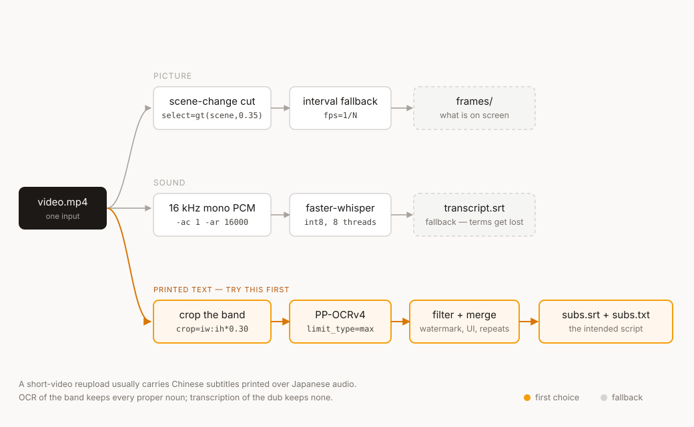

# video-content-reader

Read what a video actually says, without watching it.



Built for the case that breaks speech recognition: a Chinese-subtitled clip over a Japanese or Korean original audio track — the standard shape of a short-video reupload. The printed subtitle is the script the uploader intended; the audio is a dub nobody is listening to. This reads the printed subtitle.

## The decision that matters

| Source | When to trust it | Error rate |
|---|---|---|
| Burned-in subtitle | A subtitle is printed into the picture | Character-level OCR only |
| Embedded subtitle track | `ffprobe` reports a `subtitle` stream | Zero |
| Speech-to-text | Nothing is printed, audio is human speech | Word-level, and total on a dub |
| Keyframes | Always | — |

Running Whisper on a Japanese dub of a Chinese-subtitled anime explains nothing. OCR of the band does. Check the picture before choosing a tool.

Same sentence from the same clip, two methods:

```
Whisper : 这一切也算是和天宇宙富有关,因为残怨家一直觉得有天宇宙富的人,无配成为宙术师。
OCR     : 这一切也算是和"天与咒缚"有养 因为禅院家一直觉得 有"天与咒缚"的人 不配成为咒术师
```

Three proper nouns — 天与咒缚, 禅院家, 咒术师 — the OCR got all three, the transcription got none. That is the whole argument in one line. OCR still carries its own errors (`有养` for `有关`), but they are character-level and readable; speech recognition loses the terms the video is about.

## Install

```bash
python -m pip install rapidocr-onnxruntime        # OCR path
python -m pip install faster-whisper              # audio path
# ffmpeg + ffprobe on PATH
```

ffmpeg 7 or newer. `-vsync` is gone from 7, and the scripts use `-fps_mode`.

## Use

**1. Inspect — decide the branch before spending minutes**

```bash
python scripts/probe_video.py clip.mp4
```

Prints codec, duration, audio language, embedded subtitle tracks, and whether the bottom band carries printed text across sampled frames. Exit 0 means burned-in subtitles are present.

**2. Extract**

```bash
python scripts/subocr.py clip.mp4 --interval 0.8 --jobs 4
```

```
clip/subs.srt          timecoded
clip/subs.txt          one sentence per line
clip/ocr_raw.jsonl     per-frame boxes with coordinates and confidence
```

**3. Clean, then read**

```bash
python scripts/clean_subs.py clip/subs.txt
```

Drops kana lines (anime staff rolls), platform UI (`抖音号：`, `截图保存到相册`), two-character fragments, and the repeats a static graphic produces.

**No printed subtitle?** Take the audio path:

```bash
python scripts/vidread.py clip.mp4 --lang auto
```

Keyframes, 16 kHz mono audio, every embedded track, and a transcript in one pass.

## Measured

Ryzen 7 8845HS, 8 cores / 16 threads, CPU only. 19 minutes of footage across four clips:

| Step | Result |
|---|---|
| Frame sampling + OCR, 1445 frames | 522 s wall clock, 2.77 frames/s |
| Subtitle lines recovered | 647 |
| Whisper `small`, int8, 70.8 s audio, 8 threads | 40.2 s, 1.76× realtime |

Two settings carry most of the speed. Both are in the scripts, both are documented with the sweep that produced them in [references/ocr-tuning.md](references/ocr-tuning.md):

- `det_limit_type='max'` instead of the library default — **4.4× faster**, 1.41 → 0.32 s/frame. The default enlarges the short side of a wide subtitle band by up to 6.8×.
- Explicit `intra_op_num_threads` per worker — the default `-1` gives every worker every core, and four workers then fight over eight hardware threads.

## What breaks

Character substitution in OCR is not a bug to fix, it is the input. Reuploads of Japanese animation routinely mistype character names themselves, so the OCR faithfully reproduces `宿滩` for `宿傩` and `慈` for `茈`. Sample the actual frames, build a correction table, publish it next to the transcript.

Watermarks, staff rolls, and platform buttons share the band with the subtitle. The scripts filter by position, by script (kana), and by word list — all three are needed, none is sufficient.

Failure modes with exact error strings: [references/troubleshooting.md](references/troubleshooting.md).

## Files

```
SKILL.md                 agent-facing instructions and decision table
scripts/probe_video.py       probe + burned-in subtitle detection
scripts/subocr.py        band crop, OCR, watermark filter, sentence merge
scripts/vidread.py       keyframes + audio + embedded subs + whisper
scripts/clean_subs.py    noise removal
scripts/fetch_model.sh   whisper model download bypassing the hub API
references/ocr-tuning.md      measured parameter sweeps
references/troubleshooting.md real errors and fixes
docs/pipeline.svg             the diagram above
.github/workflows/ci.yml      lint, compile, end-to-end OCR on a synthetic clip
```

## Model download

`WhisperModel("small")` calls the hub API for validation. On networks where that endpoint is blocked or returning 500 while the file CDN is healthy, the download fails with `LocalEntryNotFoundError`. Resolve the files directly:

```bash
./scripts/fetch_model.sh small
python scripts/vidread.py clip.mp4 --model-path models/faster-whisper-small
```

## License

MIT